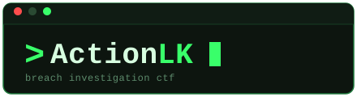
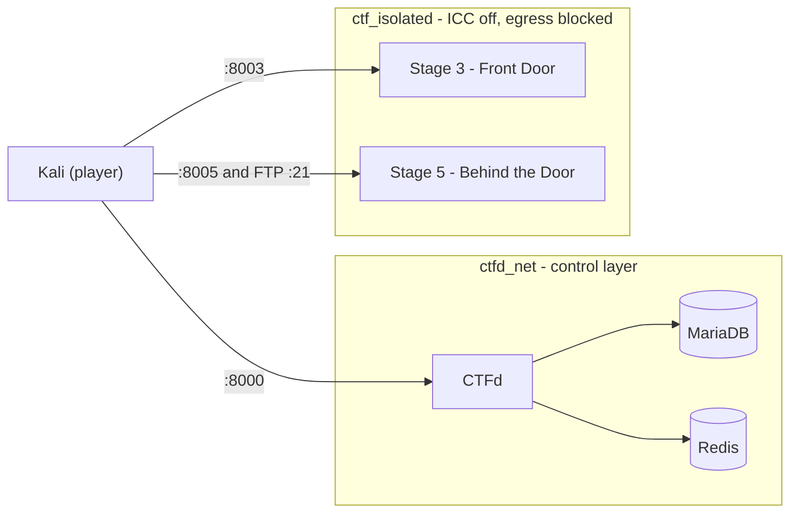

<div align="center">



### A six-stage Capture-the-Flag box, deployed with Docker and scored by CTFd


</div>

---

## Overview

**ActionLK Breach** is a chained intrusion scenario against a fictional company.
Players attack from a Kali machine and work through six stages; what they learn in
one stage feeds the next. CTFd handles registration, the scoreboard and flag
validation, while two of the stages run as live, deliberately vulnerable
containers inside an isolated Docker network.

Built for **SLIIT IE3132 — Assignment 01**. The design follows the group report:
host (Docker) → CTFd control layer → isolated challenge network → player machine.

## Architecture



- **CTFd** is the only thing players log in to; it validates every flag.
- **Stages 3 and 5** are the only live services. They sit on a separate bridge
  network with inter-container traffic disabled and outbound internet blocked
  by a host firewall rule.
- **Stages 1, 2, 4 and 6** are static files attached to challenges in CTFd.

## The six stages

| # | Challenge | Category | Delivery | Port | Designed by |
|---|-----------|----------|----------|------|-------------|
| 1 | The Public Trail | OSINT | Static file | — | Venura |
| 2 | The Encoded Note | Cryptography | Static file | — | Venura |
| 3 | Front Door | Web Security | Live container | 8003 | Venura |
| 4 | Sniffing the Wire | Networking | Static file | — | Bandara |
| 5 | Behind the Door | Web + Networking | Live container | 8005, FTP 21 | Bandara |
| 6 | The Vault | Cryptography | Static file | — | Bandara |

> Solutions are intentionally **not** in this README. Organisers can find them in
> [`docs/WALKTHROUGH.md`](docs/WALKTHROUGH.md).

## Tech stack

| Layer | Tools |
|-------|-------|
| Platform | CTFd, MariaDB 10.11, Redis 7 |
| Orchestration | Docker Engine, Docker Compose, `iptables` (DOCKER-USER rule) |
| Stage 3 | PHP, MySQL, Apache |
| Stage 5 | Flask (Python), vsftpd |
| Asset generation | Python 3 + Pillow, OpenSSL |
| Player tooling | Kali: exiftool, CyberChef, Burp Suite, Wireshark, ftp |

## Quick start

On the **Ubuntu Server 22.04** host (Docker Engine + Compose plugin installed,
see the [deployment guide](docs/DEPLOYMENT.md)):

```bash
git clone git@github.com:<owner>/actionlk-breach-ctf.git
cd actionlk-breach-ctf

# 1. create your private config (both files are git-ignored)
cp .env.example .env
cp secrets.env.example secrets.env
#    -> change every CHANGE_ME_* value, set PASV_ADDRESS to the VM's IP
#       (keep the shared values identical in both files)

# 2. generate the static challenge files from secrets.env
pip3 install --break-system-packages pillow
python3 scripts/generate_assets.py

# 3. build and start everything
docker compose up -d --build
docker compose ps        # all five services should be "Up"
```

| Service | URL |
|---------|-----|
| CTFd | `http://<vm-ip>:8000` |
| Stage 3 | `http://<vm-ip>:8003` |
| Stage 5 (web) | `http://<vm-ip>:8005` |
| Stage 5 (FTP) | `<vm-ip>:21` |

Then run the CTFd setup wizard and create one challenge per stage. The full
table (categories, attachments, flag names) is in
[`docs/DEPLOYMENT.md`](docs/DEPLOYMENT.md#6-finish-ctfd-setup).

**Reset a live stage** back to its seeded state:

```bash
docker compose restart stage3-frontdoor
docker compose restart stage5-behindthedoor
```

## Repository layout

```
actionlk-breach-ctf/
├── docker-compose.yml          # CTFd + MariaDB + Redis + two challenge containers
├── .env.example                # compose variables        -> copy to .env
├── secrets.env.example         # every flag / credential  -> copy to secrets.env
├── scripts/
│   ├── generate_assets.py      # rebuilds all static files from secrets.env
│   └── apply_theme.sh          # applies the CTFd branding via its API
├── branding/                   # logo, favicon, terminal-style CSS for CTFd
├── static-challenges/          # files attached in CTFd (stages 1, 2, 4, 6)
├── stage3-frontdoor/           # live: PHP + MySQL login portal
├── stage5-behindthedoor/       # live: Flask web portal + FTP
└── docs/
    ├── DEPLOYMENT.md           # host + Kali setup, isolation, recovery
    └── WALKTHROUGH.md          # full solutions (organisers only)
```

## Team

| Member | Role | Responsibility |
|--------|------|----------------|
| **Rupasingha R.S.M.P.S.** | CTF Platform & Architecture | Architecture, CTFd/Docker deployment, network design |
| **Venura Kithpura W.K.** | Challenge Design A | Stages 1, 2 and 3, CTFd branding |
| **Bandara L.M.I.L.** | Challenge Design B | Stages 4, 5 and 6 |
| **Wickramasinghe A.H.** | Integration, Testing & Documentation | Testing/validation, risk analysis, documentation |

Working on the repo? Read [`CONTRIBUTING.md`](CONTRIBUTING.md) first. It lists
which folders each member owns and the branch/PR workflow.

## Disclaimer

This project is **deliberately vulnerable** and exists for education in an
isolated lab. Run it only on a private network you control. Never expose it
to the internet, and never reuse its credentials anywhere else. The repository
contains challenge flags and solutions, so keep it **private**.
