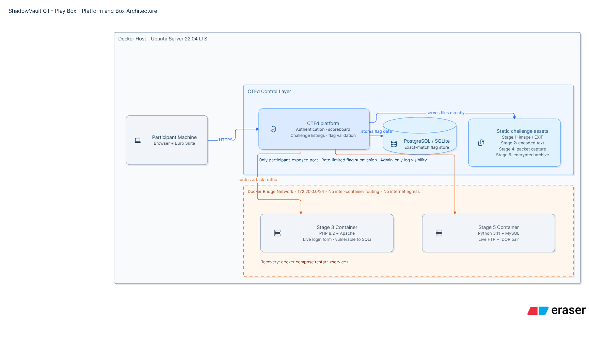

# Platform & Box Architecture

Source: Assignment 01 design report, *Platform and Box Architecture* (Figure 1)
and *Technology Stack* sections. Owner: Member 1 (Rupasingha R.S.M.P.S.).
The full report is in [`report/`](report/ActionLK-Breach-Design-Report.pdf).

<!-- TODO(Member 1): the figure's own title text still reads "ShadowVault CTF Play Box".
     Re-export it with the ActionLK Breach title and replace docs/images/architecture-diagram.png. -->

*Figure 1 — ActionLK Breach platform and box architecture.*

## Layer-by-layer description

The architecture is organised into four layers: the participant machine, the
CTFd control layer, an isolated internal network, and the challenge containers.

| Layer | Description |
|-------|-------------|
| **Participant machine** | A player's laptop or Kali VM running a browser and Burp Suite. It connects to the platform over HTTPS and is the only layer outside the isolated network. |
| **CTF portal / control layer** | CTFd handles authentication, the scoreboard, challenge listings and flag validation against its own database. It is the single host exposed to players; no challenge container is ever reachable directly. |
| **Isolated network** | An internal-only Docker bridge network (172.20.0.0/24) with no inter-container routing and no internet egress. Traffic can flow from CTFd down into a container, but containers cannot reach each other or the outside world. |
| **Challenge containers** | Stages 3 and 5 run as live Docker containers because they need a stateful application to attack (a login form, an FTP + IDOR pair). Stages 1, 2, 4 and 6 are static assets (an image, a text snippet, a packet capture and an encrypted file) served directly by CTFd. |

## Technology stack

| Layer | Technology | Purpose |
|-------|------------|---------|
| Platform / Control | CTFd | Challenge listing, scoreboard, authentication, exact-match flag validation |
| Containerisation | Docker Engine 24.x + Docker Compose | Builds and orchestrates one container per live stage plus the CTFd core stack |
| Host OS | Ubuntu Server 22.04 LTS | Stable, well-documented base for the Docker host |
| Vulnerable apps | PHP 8.2 (Apache), Python 3.11 (slim), Alpine-based services | Base images for the Stage 3 login form and the Stage 5 file-share / web app pair |
| Database | MySQL (challenge data), SQLite/PostgreSQL (CTFd) | Backing stores for the vulnerable app and the platform itself |
| Interception / Analysis | Burp Suite (Proxy + Repeater) | Intercepting, replaying and editing HTTP requests for Stages 3 and 5 |
| Network analysis | Wireshark, tcpdump | Inspecting the Stage 4 packet capture for cleartext FTP credentials |
| Encoding / Crypto | CyberChef, OpenSSL | Decoding Stage 2 and decrypting the Stage 6 vault archive |
| Metadata | exiftool | Extracting the EXIF comment used in Stage 1 |

## Deployment & isolation plan (as designed)

- The whole box is described in a single Docker Compose file, so the entire
  environment can be brought up or torn down with one command.
- Stage 3 and Stage 5 each run in their own container, with no shared state.
- The challenge bridge network (172.20.0.0/24) has inter-container
  communication disabled and no route to the internet, so a compromised
  challenge container cannot pivot or exfiltrate data.
- Static assets for Stages 1, 2, 4 and 6 are uploaded directly to CTFd and need no container.
- Recovery from a broken challenge is a single `docker compose restart <service>`.
- Extra controls: rate-limited flag submission, a unique flag per challenge,
  and admin-only visibility of the submission log.

## Design to implementation mapping

| Design element | Implemented as |
|----------------|----------------|
| CTFd core stack | `ctfd` (`ctfd/ctfd`), `ctfd_db` (MariaDB 10.11), `ctfd_cache` (Redis 7) on network `ctfd_net`, CTFd on port 8000 |
| Stage 3 container | service `stage3-frontdoor`: `php:8.2-apache` with MariaDB inside the same container, published on 8003 |
| Stage 5 container | service `stage5-behindthedoor`: `python:3.11-slim` running Flask + vsftpd, published on 8005, FTP 21 and passive ports 21100-21110 |
| Isolated network | `ctf_isolated`, 172.20.0.0/24, `enable_icc: "false"` |
| No internet egress | one `DOCKER-USER` iptables rule on the host (see [DEPLOYMENT.md](DEPLOYMENT.md), step 4) |
| Recovery | `docker compose restart stage3-frontdoor` / `docker compose restart stage5-behindthedoor` |
